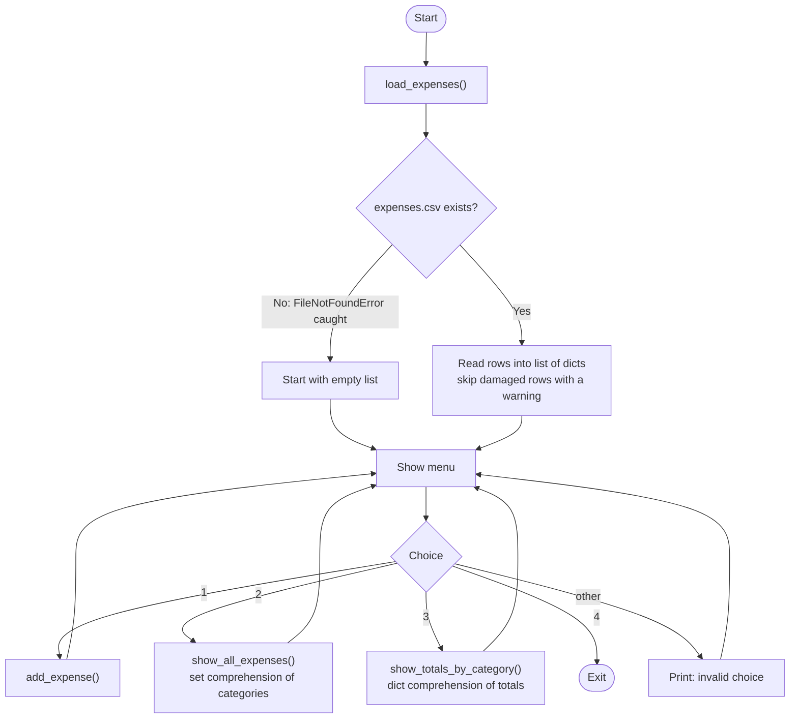
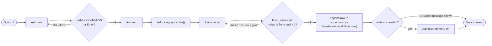
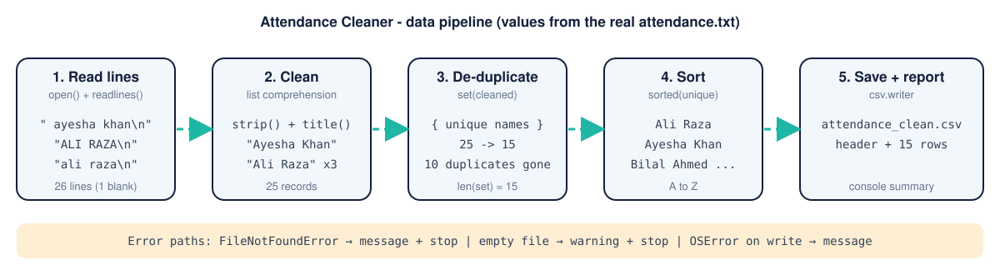
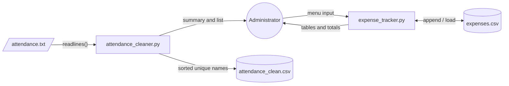

<p align="center">
  
</p>

<p align="center">
  
  
  
  
</p>

<h1 align="center">Training Institute Management Tools</h1>
<p align="center"><b>Expense Tracker</b> &nbsp;•&nbsp; <b>Attendance Cleaner</b><br>
Two command-line programs built with Python file handling, exception handling, sets and comprehensions.</p>

---

## 📑 Table of Contents

1. [Overview](#1--overview)
2. [Repository structure](#2--repository-structure)
3. [Quick start - how to run each program](#3--quick-start---how-to-run-each-program)
4. [Design: flowcharts and data formats](#4--design-flowcharts-and-data-formats)
5. [Methodology](#5--methodology)
6. [Errors handled and why](#6--errors-handled-and-why)
7. [How sets and list comprehensions are used](#7--how-sets-and-comprehensions-are-used)
8. [Sample run - expense data is saved and loaded again](#8--sample-run---expense-data-is-saved-and-loaded-again)
9. [Results](#9--results)
10. [Testing](#10--testing)
11. [Requirements checklist](#11--requirements-checklist)
12. [Limitations and future improvements](#12--limitations-and-future-improvements)
13. [Publishing to GitHub](#13--publishing-to-github)
14. [References](#14--references)

---

## 1. 📌 Overview

A training institute needs two small administrative tools. Both are plain Python 3 scripts that use **only the standard library** (`csv`, `os`, `math`, `datetime`), so they run anywhere Python is installed - no `pip install` required.

| | 💰 Expense Tracker | 📋 Attendance Cleaner |
|---|---|---|
| **File** | `expense_tracker.py` | `attendance_cleaner.py` |
| **Purpose** | Record daily operational expenses (stationery, internet bills, refreshments, transport, ...) so administration can review spending. | Turn a messy attendance list into a clean, duplicate-free, alphabetical list of students. |
| **Input** | Interactive menu (date, item, category, amount) | `attendance.txt` - one name per line |
| **Output** | `expenses.csv` (`date,item,category,amount`) + on-screen tables | `attendance_clean.csv` + on-screen summary |
| **Persistence** | Every new expense is appended to the CSV and reloaded on the next start | Output file is rewritten on each run |
| **Key concepts** | File I/O, `FileNotFoundError`, `ValueError`, set of categories, dict/set comprehensions | File I/O, `FileNotFoundError`, list comprehension, `set`, `sorted` |

---

## 2. 🗂 Repository structure

```text
python-files-errors-assessment/
│
├── expense_tracker.py        # Task 1 - Institute Expense Tracker
├── attendance_cleaner.py     # Task 2 - Student Attendance Cleaner
├── attendance.txt            # Sample raw attendance data (duplicates, odd capitalisation, extra spaces)
├── README.md                 # This document
│
└── assets/                   # Documentation material only - the programs do not need it
    ├── banner.svg                  # Animated banner
    ├── attendance_pipeline.svg     # Animated pipeline diagram
    ├── expense_demo.gif            # Animated terminal demo (real output)
    ├── attendance_demo.gif         # Animated terminal demo (real output)
    ├── expense_summary.png         # Chart generated from the sample run
    ├── attendance_summary.png      # Chart generated from attendance.txt
    ├── generate_assets.py          # Re-creates the charts and GIFs from real outputs
    └── sample_output/              # Raw transcripts and CSVs captured from real runs
```

> `expenses.csv` and `attendance_clean.csv` are **created by the programs at run time**, so they are not part of the source tree. Copies produced by the sample runs are kept in `assets/sample_output/`.

---

## 3. 🚀 Quick start - how to run each program

**Requirements:** Python 3.8 or newer (developed and tested on Python 3.12.3). No third-party packages.

```bash
git clone https://github.com/<your-username>/python-files-errors-assessment.git
cd python-files-errors-assessment
python --version        # use python3 on macOS/Linux if needed
```

### 💰 Run the Expense Tracker

```bash
python expense_tracker.py
```

Menu:

| Option | Action |
|:--:|---|
| **1** | **Add New Expense** - asks for date, item name, category and amount, then saves to `expenses.csv` immediately |
| **2** | **Show All Expenses** - table of all records plus the **set of unique categories** |
| **3** | **Calculate Total Expenses by Category** - per-category totals and a grand total |
| **4** | **Exit** |

Input rules (invalid input never crashes the program - it simply asks again):

* **Date** - `YYYY-MM-DD`; press **Enter** for today's date.
* **Item / Category** - must not be blank. Categories are normalised with `.title()` so `transport` and `TRANSPORT` become one category: `Transport`.
* **Amount** - must be a finite number greater than zero. `1250`, `99.50` and `1,250.50` are all accepted.

### 📋 Run the Attendance Cleaner

Keep `attendance.txt` in the same folder as the script, then:

```bash
python attendance_cleaner.py
```

The program reads `attendance.txt`, prints the summary and writes `attendance_clean.csv`. To test with your own data, edit `attendance.txt` (one name per line) and run it again.

<p align="center"></p>

---

## 4. 🧭 Design: flowcharts and data formats

### 4.1 Expense Tracker - program flow



### 4.2 Adding an expense - validation and saving



### 4.3 Attendance Cleaner - animated pipeline

<p align="center"></p>

### 4.4 Component view



### 4.5 Data formats

**`expenses.csv`** (header row is written automatically on first save)

| Column | Type | Example | Notes |
|---|---|---|---|
| `date` | text `YYYY-MM-DD` | `2026-11-10` | validated with `datetime.strptime` |
| `item` | text | `A4 paper and markers` | non-empty |
| `category` | text (Title Case) | `Stationery` | normalised with `.title()` |
| `amount` | number | `1250.5` | rounded to 2 decimals, converted with `float()` when loaded |

**`attendance_clean.csv`**: a header `student_name` followed by one cleaned, unique name per row in A-Z order.

---

## 5. 🔬 Methodology

The work followed five short steps.

1. **Analyse the requirements.** Each bullet of the brief was turned into a concrete behaviour (see the [checklist](#11--requirements-checklist)).
2. **Design before coding.** Data formats and flowcharts (section 4) were drawn first, and each program was split into small single-purpose functions (load, save, validate, report) so every piece can be tested alone.
3. **Implement with the required concepts.** File handling with the `csv` module and context managers (`with open(...)`), targeted `try/except` blocks, a `set` for unique values, and comprehensions for building results.
4. **Test with good and bad input.** Each program was run with valid data, invalid amounts, invalid dates, missing files, empty files, damaged CSV rows and unwritable paths. Results are in [section 10](#10--testing). Two real defects found this way were fixed:
   * *Attendance:* names containing a **double space inside** (e.g. `zainab  iqbal`) were not merged with their single-space duplicates by `strip()` alone, so inner spacing is now normalised as well.
   * *Expenses:* loading crashed with `IsADirectoryError` when `expenses.csv` was a folder, so the loader now catches `OSError` (and decoding/CSV errors) in general.
5. **Document with real evidence.** Every transcript, table, chart and GIF in this README is generated from output of the actual programs (`assets/generate_assets.py` rebuilds them) - nothing is mocked up.

**Design decisions**

| Decision | Reason |
|---|---|
| Append (`"a"`) one row per new expense | Data is on disk immediately, so a crash or closed window cannot lose it; no need to rewrite the whole file. |
| `csv` module instead of manual `split(",")` | Correctly handles items that contain commas or quotes (e.g. `Pens, blue`). |
| Header written only if the file is new or empty | Keeps the file valid CSV on every run without duplicate headers. |
| Categories normalised with `.title()` | `stationery`, `Stationery` and `STATIONERY` must count as one category in the set. |
| Reject amounts `<= 0`, `nan` and `inf` | `float("nan")` and `float("inf")` are valid floats but meaningless as money. |
| Unique sorted names saved to `attendance_clean.csv` | The goal is a *clean attendance list*; duplicates are removed, then sorted A-Z. |
| Blank lines in `attendance.txt` ignored (and reported) | A blank line is not a student record. |
| `if __name__ == "__main__":` guard | Functions can be imported and tested without launching the menu. |

---

## 6. 🛡 Errors handled and why

### 6.1 Expense Tracker

| Error / situation | Where | What happens | Why it is handled |
|---|---|---|---|
| `FileNotFoundError` | `load_expenses()` | Message printed, program starts with an **empty list** | On the very first run `expenses.csv` does not exist yet; this is normal, not a failure. |
| `ValueError` (amount) | `get_valid_amount()` | "Invalid amount" message, **user is asked again** | `float("abc")` raises `ValueError`. The loop guarantees only a valid number is ever stored. Also raised on purpose for `nan`, `inf`, zero and negative numbers. |
| `ValueError` (date) | `get_valid_date()` | "Invalid date" message, user is asked again | `strptime` rejects impossible dates such as `2026-13-45`, keeping the CSV consistent. |
| `KeyError` / `ValueError` / `TypeError` per row | `load_expenses()` | Damaged row is **skipped with a warning**, the rest loads | One hand-edited bad line must not stop the whole program from starting. |
| `OSError`, `UnicodeDecodeError`, `csv.Error` | `load_expenses()` | Message printed, empty list used | Covers permission problems, a folder named `expenses.csv`, bad encoding or corrupt CSV. |
| `OSError` (includes `PermissionError`) | `save_expense()` | Error message; the expense is **not** added to memory | Memory and disk never disagree, and the user is told the save failed. |
| `EOFError` / `KeyboardInterrupt` | `main()` | Friendly exit / return to menu | Ctrl+D or Ctrl+C should end the session cleanly instead of printing a traceback. |
| Invalid menu choice | `main()` | "Please enter a number from 1 to 4" | Any other key must not break the loop. |

### 6.2 Attendance Cleaner

| Error / situation | Where | What happens | Why it is handled |
|---|---|---|---|
| `FileNotFoundError` | `read_raw_lines()` | Clear message, program stops | Most likely mistake: running from the wrong folder or a mistyped file name. |
| `PermissionError`, `UnicodeDecodeError` | `read_raw_lines()` | Clear message, program stops | File exists but cannot be read as UTF-8 text. |
| Empty / blank-only file | `main()` | Warning, program stops | Prevents writing a CSV that contains only a header and reporting "0 students". |
| `OSError` while writing | `save_clean_list()` | Message, no false success report | The summary is printed only after the CSV was written successfully. |

---

## 7. 🧩 How sets and comprehensions are used

### 7.1 Sets - "every value only once"

A `set` stores each value once and ignores repeats, which is exactly what is needed for unique categories and unique students.

```python
# expense_tracker.py - unique categories (set comprehension)
unique_categories = {e["category"] for e in expenses}

# attendance_cleaner.py - unique students
unique_students = set(cleaned)        # 25 cleaned names -> 15 unique
final_list = sorted(unique_students)  # sets are unordered, so sort for A-Z output
```

Because membership tests and insertions in a set are O(1) on average, de-duplicating is also faster than checking `if name not in list` inside a loop.

### 7.2 Comprehensions - "build a collection in one readable line"

```python
# attendance_cleaner.py - LIST comprehension: clean every line
cleaned = [" ".join(line.strip().split()).title() for line in lines if line.strip()]

# expense_tracker.py - DICT comprehension with a generator expression: total per category
totals = {
    category: sum(e["amount"] for e in expenses if e["category"] == category)
    for category in unique_categories
}
```

### 7.3 Summary

| Where | Tool | Purpose |
|---|---|---|
| `attendance_cleaner.clean_names()` | **list comprehension** | `strip()` removes outer spaces/newline, `split()`+`join()` squeezes inner spaces, `title()` fixes capitals, `if line.strip()` skips blank lines |
| `attendance_cleaner.main()` | **set** | `set(cleaned)` removes duplicates; `len()` of it is the unique-student count |
| `expense_tracker.show_all_expenses()` | **set comprehension** | displays the unique categories |
| `expense_tracker.show_totals_by_category()` | **set + dict comprehension** | category -> total amount |

**Worked example (real data from `attendance.txt`).** `ALI RAZA`, `ali raza` and `Ali Raza ` are three different strings. After `strip()`/`title()` they become the same string `"Ali Raza"`, so the set keeps one copy - 25 records collapse to 15 unique students.

---

## 8. 🎬 Sample run - expense data is saved and loaded again

This is a **real, unedited capture** of two separate program launches in an empty folder. The scripted inputs were echoed after each prompt exactly as a user would type them.

<p align="center"></p>

*(The GIF is the same output with blank lines and repeated menus removed so it plays quickly. The complete transcripts are below.)*

### Session 1 - first launch (no CSV exists yet), three expenses added

Things to notice: the `FileNotFoundError` start-up message; `abc` and `-50` rejected and re-asked; `1,250.50` accepted; category `stationery` stored as `Stationery`; invalid date `2026-13-45` rejected.

<details>
<summary><b>Show the full Session 1 transcript</b></summary>

```text
'expenses.csv' not found. Starting with an empty expense list.

===== Institute Expense Tracker =====
1. Add New Expense
2. Show All Expenses
3. Calculate Total Expenses by Category
4. Exit

Choose an option (1-4): 1

--- Add New Expense ---
Date (YYYY-MM-DD, Enter for today): 2026-11-10
Item name: A4 paper and markers
Category: stationery
Amount: abc
  Invalid amount. Please enter a valid positive number (e.g. 1250 or 99.50).
Amount: -50
  Invalid amount. Please enter a valid positive number (e.g. 1250 or 99.50).
Amount: 1,250.50
Saved: A4 paper and markers (Stationery) - 1250.50

===== Institute Expense Tracker =====
1. Add New Expense
2. Show All Expenses
3. Calculate Total Expenses by Category
4. Exit

Choose an option (1-4): 1

--- Add New Expense ---
Date (YYYY-MM-DD, Enter for today): 2026-11-11
Item name: Internet bill
Category: internet
Amount: 4500
Saved: Internet bill (Internet) - 4500.00

===== Institute Expense Tracker =====
1. Add New Expense
2. Show All Expenses
3. Calculate Total Expenses by Category
4. Exit

Choose an option (1-4): 1

--- Add New Expense ---
Date (YYYY-MM-DD, Enter for today): 2026-13-45
  Invalid date. Please use the format YYYY-MM-DD (e.g. 2026-11-15).
Date (YYYY-MM-DD, Enter for today): 2026-11-12
Item name: Bus fare for trip
Category: transport
Amount: 1200
Saved: Bus fare for trip (Transport) - 1200.00

===== Institute Expense Tracker =====
1. Add New Expense
2. Show All Expenses
3. Calculate Total Expenses by Category
4. Exit

Choose an option (1-4): 4
Goodbye! All expenses are saved in 'expenses.csv'.
```
</details>

`expenses.csv` on disk after Session 1:

```csv
date,item,category,amount
2026-11-10,A4 paper and markers,Stationery,1250.5
2026-11-11,Internet bill,Internet,4500.0
2026-11-12,Bus fare for trip,Transport,1200.0
```

### Session 2 - program restarted: the 3 saved expenses are loaded, 2 more added

Things to notice: the first line says `Loaded 3 saved expense(s)`, option 2 immediately lists the records from Session 1, and the new rows are appended.

<details>
<summary><b>Show the full Session 2 transcript</b></summary>

```text
Loaded 3 saved expense(s) from 'expenses.csv'.

===== Institute Expense Tracker =====
1. Add New Expense
2. Show All Expenses
3. Calculate Total Expenses by Category
4. Exit

Choose an option (1-4): 2

--- All Expenses ---
No.  Date        Item                    Category            Amount
-------------------------------------------------------------------
1    2026-11-10  A4 paper and markers    Stationery         1250.50
2    2026-11-11  Internet bill           Internet           4500.00
3    2026-11-12  Bus fare for trip       Transport          1200.00
-------------------------------------------------------------------
Records: 3
Unique categories (3): Internet, Stationery, Transport

===== Institute Expense Tracker =====
1. Add New Expense
2. Show All Expenses
3. Calculate Total Expenses by Category
4. Exit

Choose an option (1-4): 1

--- Add New Expense ---
Date (YYYY-MM-DD, Enter for today): 2026-11-12
Item name: Printer ink
Category: STATIONERY
Amount: 2299.50
Saved: Printer ink (Stationery) - 2299.50

===== Institute Expense Tracker =====
1. Add New Expense
2. Show All Expenses
3. Calculate Total Expenses by Category
4. Exit

Choose an option (1-4): 1

--- Add New Expense ---
Date (YYYY-MM-DD, Enter for today): 2026-11-13
Item name: Tea and snacks
Category: Refreshments
Amount: 850
Saved: Tea and snacks (Refreshments) - 850.00

===== Institute Expense Tracker =====
1. Add New Expense
2. Show All Expenses
3. Calculate Total Expenses by Category
4. Exit

Choose an option (1-4): 2

--- All Expenses ---
No.  Date        Item                    Category            Amount
-------------------------------------------------------------------
1    2026-11-10  A4 paper and markers    Stationery         1250.50
2    2026-11-11  Internet bill           Internet           4500.00
3    2026-11-12  Bus fare for trip       Transport          1200.00
4    2026-11-12  Printer ink             Stationery         2299.50
5    2026-11-13  Tea and snacks          Refreshments        850.00
-------------------------------------------------------------------
Records: 5
Unique categories (4): Internet, Refreshments, Stationery, Transport

===== Institute Expense Tracker =====
1. Add New Expense
2. Show All Expenses
3. Calculate Total Expenses by Category
4. Exit

Choose an option (1-4): 3

--- Total Expenses by Category ---
Category                   Total
--------------------------------
Internet                 4500.00
Refreshments              850.00
Stationery               3550.00
Transport                1200.00
--------------------------------
GRAND TOTAL             10100.00

===== Institute Expense Tracker =====
1. Add New Expense
2. Show All Expenses
3. Calculate Total Expenses by Category
4. Exit

Choose an option (1-4): 4
Goodbye! All expenses are saved in 'expenses.csv'.
```
</details>

`expenses.csv` on disk after Session 2 (the first three rows are from Session 1):

```csv
date,item,category,amount
2026-11-10,A4 paper and markers,Stationery,1250.5
2026-11-11,Internet bill,Internet,4500.0
2026-11-12,Bus fare for trip,Transport,1200.0
2026-11-12,Printer ink,Stationery,2299.5
2026-11-13,Tea and snacks,Refreshments,850.0
```

✅ **Conclusion:** data entered in one run is present, correct and usable in the next run.

---

## 9. 📊 Results

### 9.1 Expense Tracker (data from the sample run above)

| Category | Records | Total | Share |
|---|:--:|--:|--:|
| Internet | 1 | 4,500.00 | 44.6 % |
| Stationery | 2 | 3,550.00 | 35.1 % |
| Transport | 1 | 1,200.00 | 11.9 % |
| Refreshments | 1 | 850.00 | 8.4 % |
| **Grand total** | **5** | **10,100.00** | **100 %** |

Unique categories found by the set: **4** (Internet, Refreshments, Stationery, Transport).

<p align="center"></p>

### 9.2 Attendance Cleaner (data from the supplied `attendance.txt`)

| Metric | Value |
|---|:--:|
| Lines in file | 26 |
| Blank lines ignored | 1 |
| **Original number of records** | **25** |
| **Unique students (size of the set)** | **15** |
| Duplicates removed | 10 |

Examples of the cleaning step:

| Raw line (shown with quotes) | Cleaned name |
|---|---|
| `"  ayesha khan"` | Ayesha Khan |
| `"ALI RAZA"` | Ali Raza |
| `"bilal Ahmed  "` | Bilal Ahmed |
| `"  zainab  iqbal"` (two spaces inside) | Zainab Iqbal |
| `"Fatima NOOR  "` | Fatima Noor |

<p align="center"></p>

Full console output of the run:

```text
==============================================
        STUDENT ATTENDANCE CLEANER
==============================================
Original number of records : 25
(blank lines ignored       : 1)
Unique students            : 15
Duplicates removed         : 10
Saved to                   : attendance_clean.csv
----------------------------------------------
Cleaned attendance list:
  1. Ali Raza
  2. Ayesha Khan
  3. Bilal Ahmed
  4. Danish Mehmood
  5. Fatima Noor
  6. Hamza Yousaf
  7. Hassan Ali
  8. Khadija Aslam
  9. Maryam Siddiqui
 10. Nimra Shahid
 11. Omar Farooq
 12. Sara Malik
 13. Talha Javed
 14. Usman Tariq
 15. Zainab Iqbal
```

---

## 10. 🧪 Testing

Testing was done by running the programs with scripted inputs (no automated test framework is included). All rows below were executed and passed.

| # | Program | Test | Expected | Result |
|:-:|---|---|---|:-:|
| 1 | Expense | First start with no `expenses.csv` | `FileNotFoundError` caught, empty list, menu appears | ✅ |
| 2 | Expense | Amount `abc` | "Invalid amount", asked again | ✅ |
| 3 | Expense | Amount empty / `-50` / `0` | Rejected, asked again | ✅ |
| 4 | Expense | Amount `nan` and `inf` | `nan`, `inf` and `0` each rejected and re-asked; `10` then accepted | ✅ |
| 5 | Expense | Amount `1,250.50` | Stored as `1250.5` | ✅ |
| 6 | Expense | Date `2026-13-45` | "Invalid date", asked again | ✅ |
| 7 | Expense | Blank date | Today's date used | ✅ |
| 8 | Expense | Blank item name | "cannot be empty", asked again | ✅ |
| 9 | Expense | Category `stationery` then `STATIONERY` | Both stored as `Stationery`; one category in the set | ✅ |
| 10 | Expense | Menu choice `99` | "Invalid choice" and menu again | ✅ |
| 11 | Expense | Restart program | Previous rows loaded, new rows appended, header not duplicated | ✅ |
| 12 | Expense | CSV with a non-numeric amount row and a one-column row | Both rows skipped with warnings, valid row loaded | ✅ |
| 13 | Expense | `expenses.csv` is a directory | Load and save errors reported, no traceback | ✅ |
| 14 | Expense | End of input (Ctrl+D) | Clean exit message | ✅ |
| 15 | Attendance | Supplied `attendance.txt` (duplicates, mixed case, extra spaces, blank line) | 25 records -> 15 unique, sorted A-Z, CSV with 15 rows + header | ✅ |
| 16 | Attendance | `attendance.txt` missing | `FileNotFoundError` message, stop | ✅ |
| 17 | Attendance | File with only blank lines | Warning, stop | ✅ |
| 18 | Attendance | `attendance_clean.csv` is a directory | Write error reported, no success summary | ✅ |
| 19 | Both | `python -m py_compile` | No syntax errors | ✅ |

---

## 11. ✅ Requirements checklist

### Task 1 - `expense_tracker.py`

| Requirement | Where it is met |
|---|---|
| Save expenses in `expenses.csv` with columns `date,item,category,amount` | `FIELDNAMES`, `save_expense()` (`csv.DictWriter`) |
| Load saved expenses on start; catch `FileNotFoundError` and start empty | `load_expenses()` |
| Menu: 1 Add, 2 Show, 3 Totals by category, 4 Exit | `MENU`, `main()` |
| Enter date, item, category, amount | `add_expense()` |
| Catch `ValueError` for invalid amount and ask again | `get_valid_amount()` |
| Use a **set** to display unique categories | `show_all_expenses()` - `{e["category"] for e in expenses}` |
| New expenses saved so they persist | `save_expense()` is called for every new expense |

### Task 2 - `attendance_cleaner.py`

| Requirement | Where it is met |
|---|---|
| Read names from `attendance.txt`, one per line | `read_raw_lines()` |
| Clean with `strip()` and `title()` using a **list comprehension** | `clean_names()` |
| Use a **set** for unique students and the unique count | `set(cleaned)`, `len(unique_students)` |
| Sort cleaned names alphabetically | `sorted(unique_students)` |
| Save to `attendance_clean.csv` | `save_clean_list()` |
| Display original count, unique count and cleaned list | `main()` |

### Repository and README

| Requirement | Status |
|---|---|
| Structure: `expense_tracker.py`, `attendance_cleaner.py`, `attendance.txt`, `README.md` | ✅ (plus an `assets/` folder for documentation visuals) |
| README: overview, how to run, errors handled and why, sets and comprehensions, sample run of save/load | ✅ Sections 1, 3, 6, 7, 8 |
| Tested with invalid amounts and duplicate attendance names | ✅ Section 10 |

---

## 12. 🔭 Limitations and future improvements

* **`str.title()` is simple.** It turns `mcdonald` into `Mcdonald` and `o'neil` into `O'Neil`; names with unusual capitalisation would need custom rules.
* **Different spellings are different names.** `Mohammad` and `Muhammad` are not merged - only case and spacing are normalised.
* **No edit/delete for expenses.** The CSV can be edited by hand; the loader safely skips damaged rows.
* **Single currency, no currency symbol.** Amounts are plain numbers.
* **No automated test suite.** Testing was scripted and manual; a `pytest` suite would be the natural next step (the `main()` guard already makes the functions importable).

Ideas for future work: monthly/date-range reports, deleting or editing an expense, exporting charts directly from the app, and merging attendance from several days.

---

## 13. 📤 Publishing to GitHub

```bash
cd python-files-errors-assessment
git init
git add expense_tracker.py attendance_cleaner.py attendance.txt README.md assets
git commit -m "Add expense tracker, attendance cleaner and documentation"
git branch -M main
git remote add origin https://github.com/<your-username>/python-files-errors-assessment.git
git push -u origin main
```

Create the repository as **Public** on GitHub first (name: `python-files-errors-assessment`), then submit its URL on the LMS.

---

<p align="center">
  <b>Author:</b> &lt;Madiha Shabbir | Assignment#4: python files errors assessment
</p>
